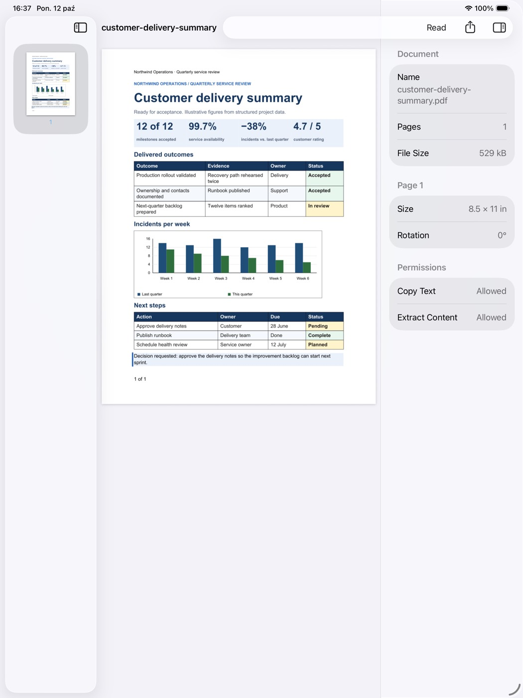
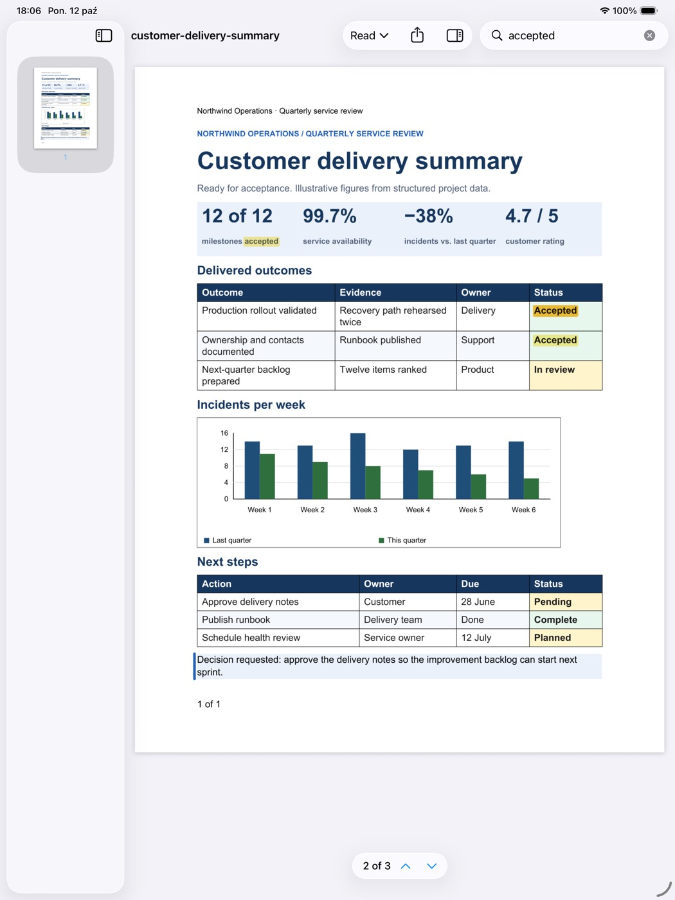
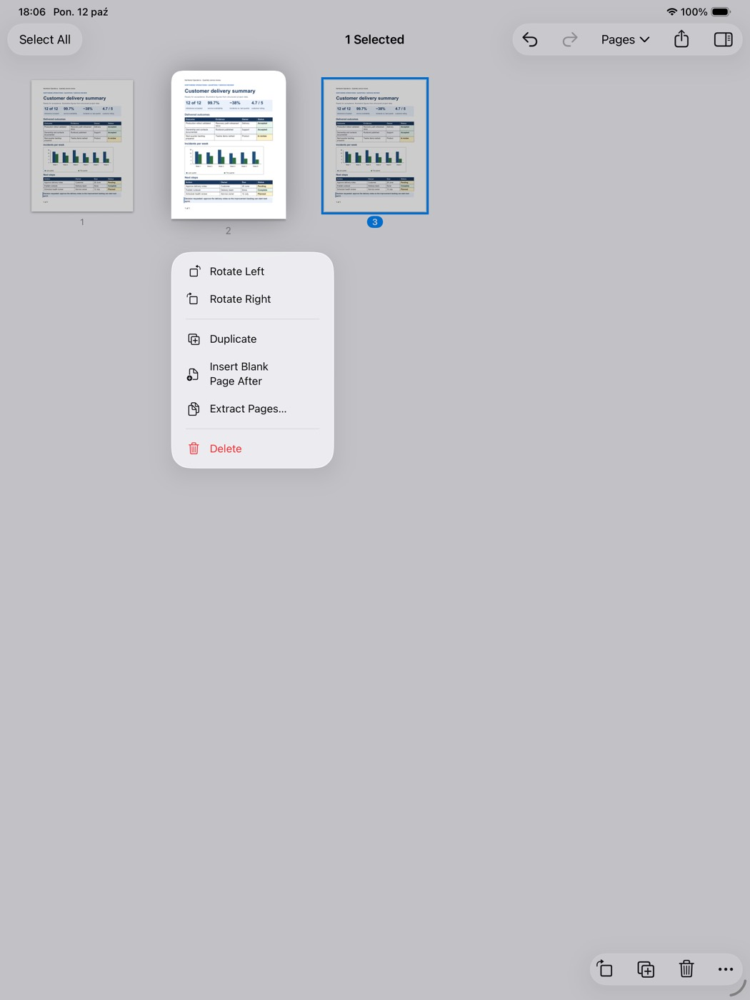
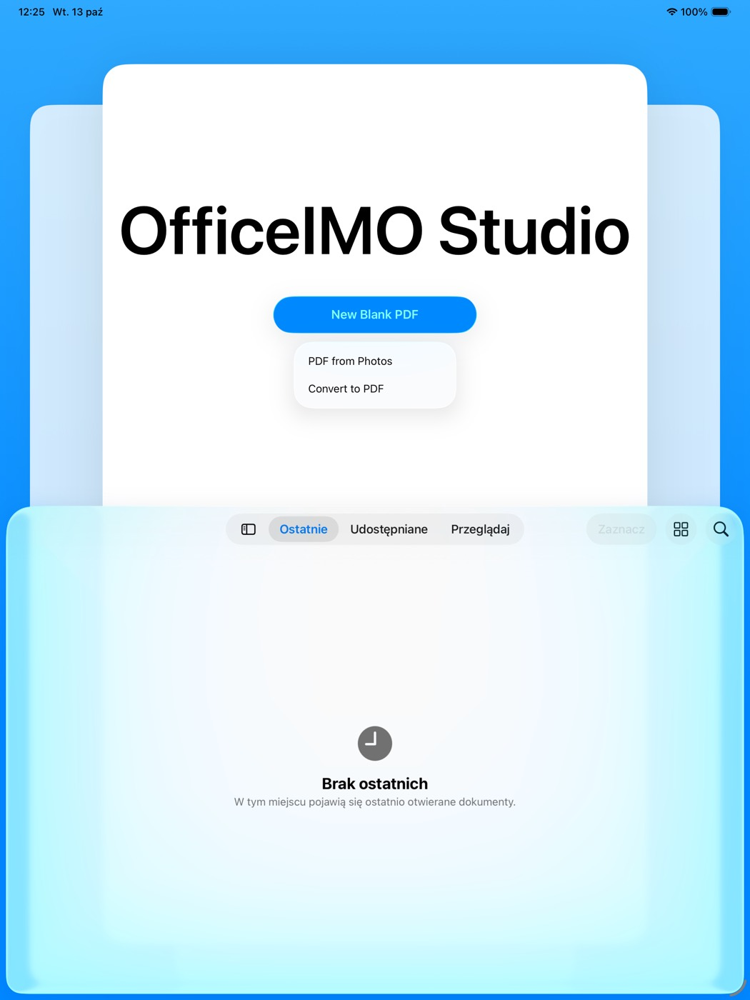
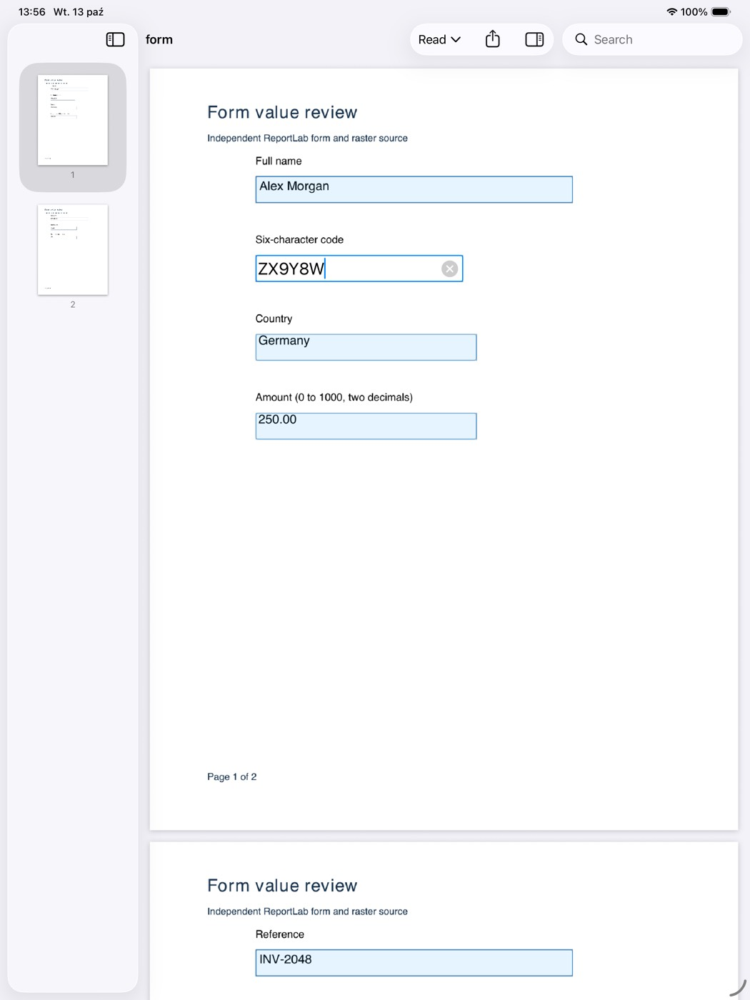
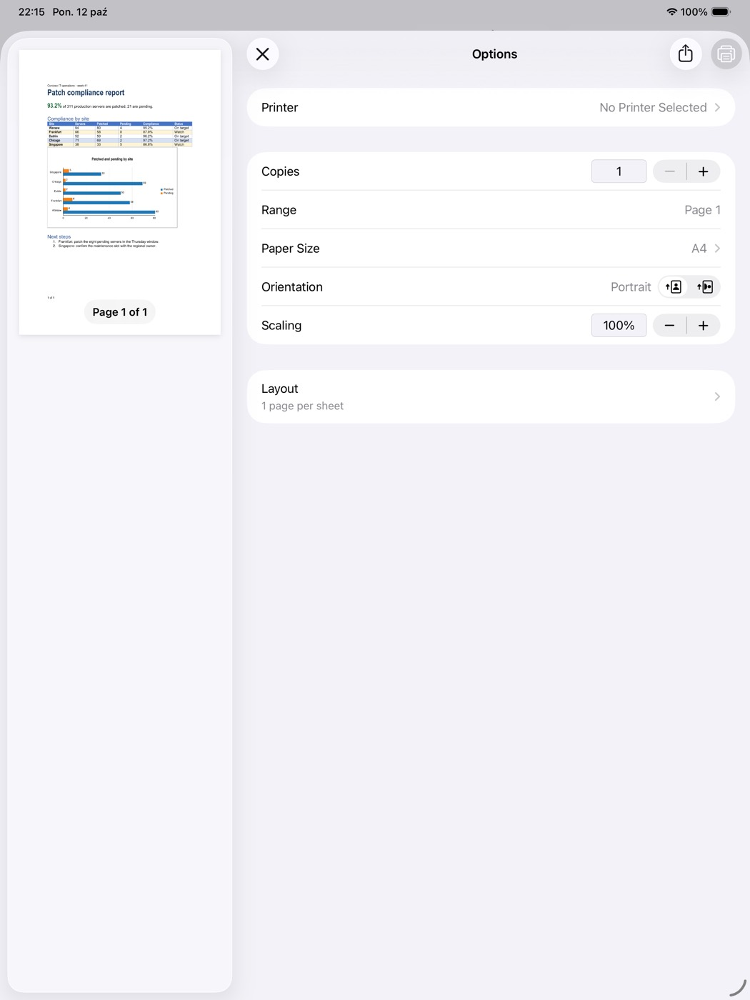
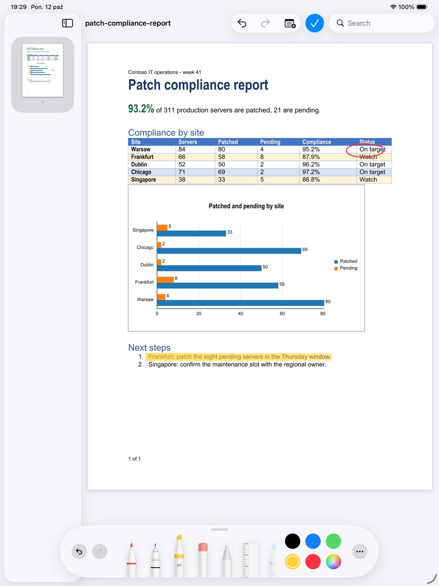
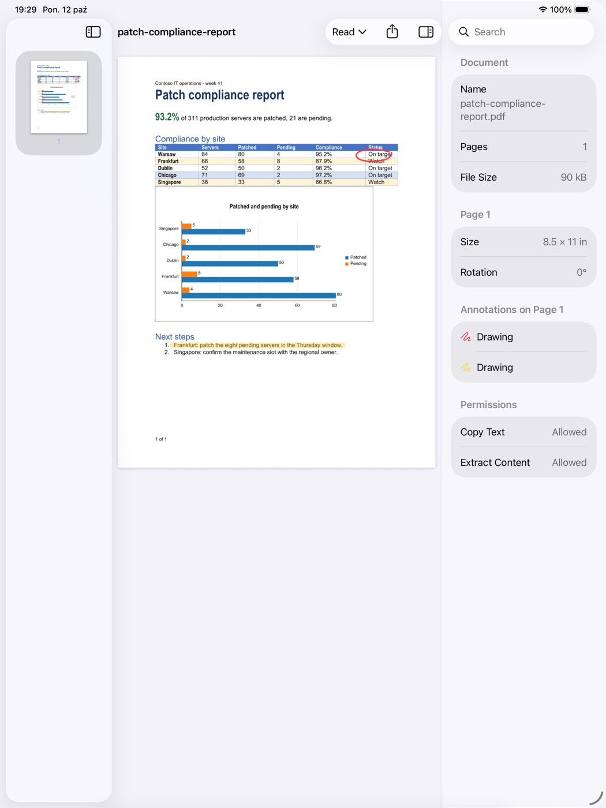
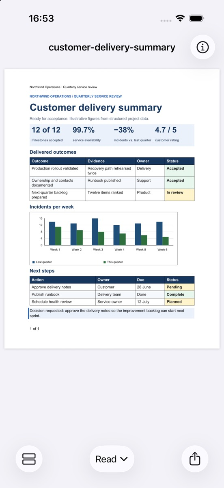
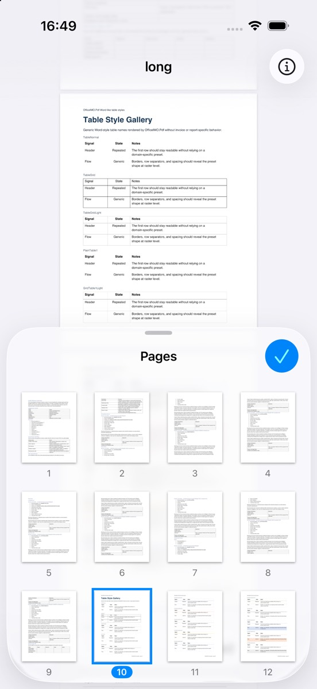

# OfficeIMO Studio native Apple apps design

OfficeIMO Studio on macOS, iPadOS and iOS is a set of native apps written in Swift, using SwiftUI and AppKit or UIKit where a platform needs them. Each app uses the OfficeIMO engines and Studio's document behaviour through one C# library compiled with NativeAOT. Windows and Linux keep the Avalonia Studio. This document describes the boundary between the two halves. The library's current contract is the header [`officeimo_studio.h`](../OfficeIMO.Studio.Native/include/officeimo_studio.h), and open work lives in the [Studio roadmap](ROADMAP.md#phase-7-native-apple-apps).

## Decision

Native apps get each platform's conventions without imitating them: document browsers and `NSDocument`/`UIDocument` lifecycles, the menu bar, Files and the share sheet, security-scoped bookmarks, Pencil, pointer and keyboard on iPad, size classes from iPhone to a large display, VoiceOver, and system typography. The document engines stay in C#, because rewriting them would duplicate the formats, fidelity rules, preservation reports and tests that already exist.

Three alternatives were considered:

| Alternative | Why it was not chosen |
| --- | --- |
| Keep Avalonia on Apple platforms | One codebase, but the result follows Avalonia's controls rather than the platform's. Native menus, the document lifecycle, sandbox storage and iPhone layouts all need per-platform work that a native app gets from the system |
| Native UI written in C# through .NET's iOS and macOS bindings | Viable, and the C interface below keeps it possible. Swift was chosen for SwiftUI, previews, Xcode tooling and the platform's own documentation and samples |
| Rewrite the engines in Swift | Duplicates every format engine and its qualification, and splits behaviour between platforms |

The Avalonia macOS build and the Avalonia iOS host remain in the repository until the native apps cover the everyday journeys. They receive fixes, not new Apple-specific features.

## Layers

| Layer | Owner | Notes |
| --- | --- | --- |
| Presentation, navigation, menus, gestures, accessibility, localization | Swift app per platform | Platform idioms; strings in the app's String Catalog |
| File access: document browser, security-scoped URLs, bookmarks, recent documents, file coordination, iCloud | Swift app | The engine only receives paths the app can currently read or write |
| C interface: handles, memory, status codes, cancellation, JSON payloads | `OfficeIMO.Studio.Native` | Thin; no document logic |
| Document sessions, editing, undo/redo, recovery copies, verified saving, workflows | `OfficeIMO.Studio.Core`, `OfficeIMO.Workflows` | The same types the desktop Studio uses |
| Formats, rendering, conversion, OCR geometry | OfficeIMO engines | Unchanged |

Document behaviour belongs in Studio.Core, and the C interface exposes it. If a native app needs behaviour the desktop already has, such as an identity check before saving, the interface exposes the existing implementation rather than re-implementing it in Swift.

## C interface rules

- **Calls block.** The app calls from a background task, never the main actor. The engine serializes calls on one document, and separate documents run concurrently. A Swift `actor` per document is the natural wrapper.
- **Status and message.** Fallible calls return an `officeimo_status` and, on failure, a UTF-8 message the app may show. Exceptions never cross the interface. Password prompts, unsupported content and cancellation have their own statuses so the app can respond without parsing text.
- **Memory.** Strings, JSON and image bytes returned by the library are released with `officeimo_free`. Each handle (document, cancellation) has its own release function and is released exactly once. Inputs are borrowed for the duration of the call.
- **Structured results** are JSON produced by source-generated serializers, so NativeAOT needs no reflection. Field names are camelCase and stable within an ABI version.
- **Versioning.** Adding a function or an optional JSON field is compatible. Changing a signature, removing a field or changing its meaning raises `officeimo_abi_version`, and the app checks it at launch against `OFFICEIMO_ABI_VERSION`.
- **Cancellation** tokens may be cancelled from any thread while a call runs.
- **Initialization.** `officeimo_initialize` names an app-owned folder inside the container for recovery copies. Opening a document before that fails with `OFFICEIMO_NOT_INITIALIZED`.

## Storage boundary

The app owns every grant to user files. The system's document group reads the user's file, coordinates access, autosaves, keeps versions and handles moves and renames. The engine works on a private working copy in the app's temporary folder, so it never needs access to the user's file. When the system saves, the engine saves the working copy in place on the system's saving thread, and the system writes those bytes to the user's file. Each edit registers an undo with the window's undo manager, which drives the Edit menu, the undo gestures and the edited state. Where the app hands the engine a user file directly, it starts security-scoped access, passes the path and keeps access open for the call. The engine never retains access, bookmarks or recent-document lists.

Saving writes beside the destination and replaces it only once the output is complete, so a failed save leaves the previous file. An in-place save refuses when the file was replaced or moved since it was opened, which can happen with iCloud or another app. The app then offers to save elsewhere or reload. The app wraps saves in its file-coordination and document lifecycle: a coordinated write for replacing, version conflicts and autosave policy are host decisions.

Recovery copies of unsaved edits live under the folder given to `officeimo_initialize`. The document facts report `hasRecovery` when an earlier session left edits for the opened file.

## Interface design

The apps follow Apple's Human Interface Guidelines and are built from the system's own components, so they look and behave like the platform and gain its features as it evolves: the system accent color, Dynamic Type, Liquid Glass toolbars, keyboard navigation and VoiceOver. Studio keeps its task names where the platform has no convention, its commands and its document behaviour. Each feature is implemented with the platform framework that provides it rather than carried over from the Avalonia app; a feature a device cannot support properly is left out there rather than imitated.

**Liquid Glass, so macOS, iPadOS and iOS 26 and later.** The apps require the 26 releases, the first with Liquid Glass, and build with the current SDK. Glass belongs to the navigation layer: the sidebar, inspector, toolbars, sheets, menus and popovers are the system's own and float over the page, which runs underneath them. The apps never paint opaque backgrounds behind bars, sidebars or sheets. Actions for a selection, such as rotating the pages chosen in the Pages task, sit in the system toolbar: the bottom bar on iPad and iPhone, the window toolbar on the Mac. The page number that floats over the pages while they scroll is the custom glass control, drawn with `glassEffect`; any further floating controls join it in one `GlassEffectContainer` so they sample the page together. Glass is never applied to content: pages, thumbnails and list rows stay opaque. Tint marks the primary action only. Reduce Transparency, Increase Contrast and Reduce Motion are checked on every screen. The 26 releases also bring the Vision document recognition, background continuation of user-started work and the iPad menu bar that the features below use.

**One document per window.** On the Mac each document has its own window, and the system's window tabs replace Studio's tab bar. On iPad each document is a scene, so documents sit side by side in split view, Stage Manager or separate windows. An iPhone shows one document at a time.

**Layout follows the width, not the device.** `NavigationSplitView` and the inspector adapt by size class, so three layout families cover every screen without device checks:

| Width | Where | Document layout |
| --- | --- | --- |
| Compact | iPhone, a folded iPhone Duo, Slide Over and narrow split view | The page fills the screen with icon buttons in the bottom toolbar; the sidebar's lists and the inspector are sheets |
| Regular | iPad in portrait, an unfolded iPhone Duo (about 626 points wide), wider split view | The page with the sidebar or the inspector, as the split view's automatic column behaviour arranges them |
| Wide | iPad in landscape, the Mac | Sidebar, page and inspector side by side |

**Fold and unfold.** Changing between compact and regular width keeps the document, the page, the zoom relative to the page width, the selection, the task and any edit in progress, held in the scene's state rather than the view. A sheet that is open in compact width becomes its column when the width grows, and an open column becomes a sheet when the width shrinks, which is the split view's and inspector's own behaviour. Visible tiles render again at the new width.

### System components

| Surface | macOS | iPadOS and iOS |
| --- | --- | --- |
| Documents and their lifecycle | `DocumentGroup` over `NSDocument`: open and save panels, Open Recent, autosave, versions, Duplicate, Rename, Move To, Revert To | `DocumentGroup` over `UIDocument` with the system document browser; `DocumentGroupLaunchScene` adds the quick tasks |
| Starting point | A Welcome window (`Window` scene) with recent documents and quick tasks | The document browser's launch screen with quick-task actions |
| Document layout | `NavigationSplitView` with a sidebar and `.inspector` | The same; compact width collapses to the page with sheets |
| Task picker | Segmented control in the window toolbar | Menu button in the navigation bar |
| Commands | Menu bar (`.commands`) with keyboard shortcuts | The iPad menu bar and keyboard shortcuts from the same `.commands` |
| Search | `.searchable` in the toolbar; Find (⌘F) | `.searchable`; a toolbar button on iPhone |
| Markup tools | Markup toolbar below the window toolbar, as in Preview | `PKToolPicker` over a `PKCanvasView`, the tool picker Notes, Files and Photos use, on iPad and iPhone |
| Colors and fonts | System colors and `ColorPicker`; the system font | The same |
| Sharing | `ShareLink` and the share menu | The share sheet (`UIActivityViewController`), whose Print draws the engine's pages |
| Printing | `NSPrintOperation` with the print panel, drawing the engine's pages | `UIPrintInteractionController` with a page renderer drawing the engine's pages |
| Notices | A bar below the toolbar with its action | A banner above the page with its action |
| Progress of long work | Progress in the Jobs window and the Dock icon; a notification when work finishes in the background | Progress in Jobs; background work continues as a background task and notifies when done |
| Settings | The Settings window (⌘,) | A Settings screen in the app |

Pages render through the engine's pixel rectangles, described under Rendering, so documents look the same as in the desktop Studio. Text selection, search highlights and form fields are system views over the page, which keeps them accessible to VoiceOver and Scribble.

### Delivered screens

The apps open PDFs as documents and offer the Read, Markup and Pages tasks, on the Mac, iPad and iPhone. Pages show at the width of the widest page and zoom with pinch, double tap, the trackpad and View ▸ Zoom; the page list, inspector and sharing work in every layout. Search uses the system search field and Find (⌘F): hits are marked on the pages as each page is searched, the current one more strongly, the first hit at or after the page in view is shown as soon as it is found, and a glass find bar over the pages shows the progress and steps through them (⌘G, ⇧⌘G). The Pages task rotates, duplicates, deletes and extracts the selected pages, inserts a blank page and reorders pages by drag and drop, from the toolbar, each page's context menu and the Tools menu; every change but extraction is one undoable step. Extraction writes a new PDF and opens the system's export panel. Markup on iPad and iPhone is PencilKit: the system tool picker over the page, with Apple Pencil or a finger, its eraser, lasso, ruler and colours. Strokes stay editable on the canvas until Done, a page change or leaving the task adds them to the document as ink annotations, one per ink, width and opacity, in one undoable change; Undo acts on the pending strokes first. On the Mac, Markup draws with the pen or the highlighter in the colour chosen in the toolbar, as Preview's Sketch tool does, each stroke one undoable change. In the Read task, text is selected along the page's reading order: on iPad and iPhone press and hold to select a word and keep dragging to extend, then the system edit menu offers Copy, Highlight, Underline and Strikethrough; on the Mac drag across text or double-click a word, copy with Edit ▸ Copy or ⌘C, and the context menu offers the same markup. On iPad and iPhone, grab handles at both ends of a selection move that end while the other stays, as in Safari and Notes. Text markup is one annotation covering the selected lines. Add Note puts a note in the middle of the page in view. The inspector lists the current page's annotations with Delete and, for notes, Edit. Annotations are written as an appended revision where a document requires it, such as a tagged or signed PDF, so Markup works on documents whose pages cannot be rewritten. When the engine reports that a document's pages cannot be rewritten safely, such as a tagged or form-bearing PDF, the Pages task says so and its edits are unavailable. On iPad and iPhone the Pages task shows Undo and Redo in the navigation bar, as Apple's editing apps do; they act through the window's undo manager, as the Edit menu and the undo gestures do. **New Blank PDF** creates a one-page document at the region's paper size. Paper becomes a searchable PDF from the launch screen on iPad and iPhone, with **Scan Document** (the VisionKit document camera, shown where the device has a camera) or **PDF from Photos** (the system photo picker, pages in the order chosen), and on the Mac with File ▸ New PDF from Images… or File ▸ Import from iPhone or iPad, Continuity Camera's Scan Documents and Take Photo. Each image becomes a page, kept to at most 3,300 pixels on its longer side, which holds 300 dpi for a letter page. Vision recognizes its text on the device, and the engine writes the words as an invisible text layer where they appear. Search, selection and copying then work as on any PDF; the engine reports the gaps between recognized words, so a word selects alone and copied text keeps its spaces. The result is a new untitled document, as Preview's scans are. Convert to PDF, on the iPad and iPhone launch screen and in the Mac's File menu, converts a Word, Excel, PowerPoint, RTF, text, HTML, Markdown, XPS, Visio, Draw or Publisher document with the same routes as OfficeIMO Studio's Convert window, entirely on the device, and opens the PDF as a new document; the file pickers offer only the formats the engine converts. Insert Pages from File… in the Pages task, a page's context menu and the Tools menu inserts the pages of chosen PDFs after the selected pages as one undoable change, asking for the password of a protected one by name. Make Searchable, in the Tools menu and the task menu, reads the text of scanned pages: the engine renders each page and Vision recognizes it on the device, and the words become invisible text as one undoable change, while a bar over the page shows the page being read and offers Cancel. Pages that already have text keep it; when nothing new is found, the document is unchanged and the app says so. Forms are filled in the Read task, as in Preview and Files: tap or click a text field to type in it, with AutoFill offered for name, address, email and phone fields, a check box or radio button to set it, or a choice for its options. Return, Tab on the Mac or tapping elsewhere adds the value, Escape leaves the field unchanged, a field's length limit is kept while typing, and each value is one undoable change that the engine draws into the field's appearance. Forms that carry Adobe usage rights, as IRS forms do, open read-only for now. Signature, in the task menu, signs with a handwritten signature as Preview does: draw it once with a finger, Apple Pencil, the trackpad or the mouse, and it is kept on the device; choose it, then tap or click where to sign, and it is added as ink in one undoable change. Protect with Password…, Remove Password… and Sign with Certificate…, in the File menu and the task menu, write a copy of the document as shown and offer it to save, as Extract Pages does: with a password to open it and the permissions to print, copy and change it, without its password, or with an invisible certificate signature from a .p12 or .pfx file, so readers can verify who signed it and that it hasn't changed since. Share sends the document as it is shown: with unsaved changes, it writes a copy of the open revision under the document's name. The system's autosave and versions keep unsaved work, so the apps don't add OfficeIMO Studio's recovery prompt. Shortcuts offers Convert to PDF, Combine PDFs, Make PDF from Images, Make PDF Searchable, Extract PDF Pages and Get Text from PDF, with phrases for Siri and Spotlight; each runs on copies of the files it is given, without opening the app, through the same engine calls as the document windows, and returns a new PDF or the text. A protected PDF is reported by name rather than asked for. File ▸ Print… (⌘P) opens the system print panel on the Mac and the print sheet on iPad, and the share sheet's Print does the same on iPad and iPhone. The system chooses the printer, paper, page range and copies and previews the pages; each page is the engine's own rendering, drawn at the resolution of the preview or the printer within the render budget, scaled to fit the printable area and turned a quarter when that fits it larger. Paper therefore matches the screen, as in OfficeIMO Studio on Windows and Linux, rather than the system's own PDF renderer. Printing is unavailable when the document's permissions forbid it, unless it was opened with its owner password, and while drawing waits to be added. The apps are in English, Polish, German and French, the languages of OfficeIMO Studio on Windows and Linux, with one set of String Catalogs for the Mac, iPad and iPhone. The iPad and iPhone screens were captured through the development launch harness described in the [app README](../Apple/OfficeIMOStudio/README.md#development-harness), because the simulator's document browser cannot open files on this build host.

| Screen | Image |
| --- | --- |
| Mac, Read: the system sidebar, the window toolbar with the task control, zoom, Share and the inspector |  |
| iPad, Read: sidebar, page and inspector side by side |  |
| iPad, Read with search: hits marked on the page, the current one in orange, and the find bar with its count |  |
| iPad, Pages: a page's context menu; Rotate, Duplicate, Delete and More sit in the bottom bar, Undo and Redo in the navigation bar, and the page list steps aside |  |
| iPad, a page made from a photo of a printed report: Vision's words are an invisible text layer, so search marks them on the scanned glyphs |  |
| iPad, Make Searchable on a photographed page: the engine renders each page for Vision, and a glass bar shows the page being read with Cancel |  |
| iPad, the launch screen: New Blank PDF, with PDF from Photos and Convert to PDF under More, where the system places further actions |  |
| iPad, filling a form in the Read task: a text field takes the keyboard and keeps the field's six-character limit, and the country was chosen from the field's options |  |
| iPad, Print from the share sheet: the system print sheet previews the engine's own rendering of the page and chooses the printer, range, paper and copies |  |
| iPad, Read with a text selection: the line selected along its words, with the system edit menu's Copy and text markup |  |
| iPad, Markup: the system tool picker with the pen and the highlighter on the page, and Undo, Redo, Add Note and Done in the navigation bar |  |
| iPad, after Done: the strokes are annotations in the rendered page, listed in the inspector with their colours |  |
| iPhone, Read: the page fills the width; Pages, the task menu and Share are separate controls in the bottom bar |  |
| iPhone, page list: a sheet at half height over the page it controls; choosing a page shows it behind the sheet |  |

### Features on each platform

| Feature | Mac | iPad | iPhone |
| --- | --- | --- | --- |
| Open from Files and cloud providers | Finder, Open With, drag and drop, iCloud Drive | Files, Open in place, drag and drop, Open in from other apps | Files, Open in place, Open in from other apps |
| Scan paper into a PDF | Continuity Camera from an iPhone or iPad (`ImportFromDevicesCommands`) | Document camera (VisionKit) | Document camera (VisionKit) |
| Recognize text (OCR) | Vision framework on the device | Vision framework on the device | Vision framework on the device |
| Markup | Pointer and trackpad tools; Markup toolbar | Apple Pencil with the system tool picker, finger drawing, pointer | Finger drawing with the system tool picker |
| Fill forms | Keyboard, Tab order, AutoFill for contact fields | Keyboard, Scribble with Apple Pencil, AutoFill | Keyboard, AutoFill |
| Sign | Visual signature drawn with the trackpad, certificate signing from the keychain | Visual signature with Apple Pencil, certificate signing from the keychain | Visual signature with a finger, certificate signing from the keychain |
| Comments | Writing Tools where available | Writing Tools where available, Scribble | Writing Tools where available |
| Organize pages | Drag pages within and between windows | Drag pages within and between windows, multiple selection | Selection mode with a bottom toolbar |
| Convert and combine | Convert window; Shortcuts actions | Quick tasks; Shortcuts actions; share extension | Quick tasks; Shortcuts actions; share extension |
| Automation | App Intents for Shortcuts, Siri and Spotlight | The same | The same |
| Continue elsewhere | Handoff of the open document and page | Handoff | Handoff |

**Settled by convention.** The annotation task is **Markup**, the name Preview, Files and Photos use. Every task is available in compact width, presented one at a time with sheets, because the platform expects the same capabilities on iPhone; a task that needs a large canvas, such as editing page text, opens full screen. The split view decides whether the sidebar sits beside or over the page on an unfolded iPhone Duo, and the app does not override it. Convert, Make searchable and Combine start from the launch screen's quick tasks, Shortcuts actions and the share extension; Jobs is a screen the launch screen and each document's Tasks menu open.

## Rendering

The app shows pages with `officeimo_document_render_region`. It renders a rectangle of the page image at a scale as opaque RGBA pixels, which the app wraps in a `CGImage` without copying and releases with `officeimo_free`. A page that fits the 8.4 million pixel budget (`maxRenderPixels` in the document facts) renders as one rectangle. Zooming further renders the visible tiles, which join without seams. The app clamps a whole-page scale to the budget, rounding each side up to whole pixels as the engine does. `officeimo_document_render_page` returns PNG for thumbnails, sharing and export.

The page view is the system's own scroll view: a zooming `UIScrollView` on iPad and iPhone and a magnifying `NSScrollView` on the Mac, so pinch, double tap, smart zoom, scroll indicators and rubber-banding behave as in other apps. The pages are layers laid out in PDF points, and the scroll view scales them. Each visible page has a preview of about 1.2 million pixels under 512-pixel tiles of the visible area at the current zoom. Tiles render nearest the middle of the view first, and those that scroll away are cancelled, which cancels the engine call. While a pinch is in progress the existing images scale; when it ends, tiles render at the new zoom, and those of the previous zoom stay until the new ones cover the view. Previews and tiles away from the visible area are released.

The engine keeps the drawings of the last two pages it rendered for the document's current revision, with up to 64 MiB of their decoded and prefiltered images. Further tiles, zoom levels and repeated views of those pages skip reading and decoding them. A page's drawing serves every zoom level unless the page has function shadings, which are drawn again for each power of two of the scale. Larger caches raised the peak footprint on scanned documents to 1.8 GB. The engine also runs its garbage collector in conserve-memory mode, which compacts the large-object heap sooner after a render's short-lived buffers.

The renderer has a separate working budget of 64 million pixels for the page image, intermediate surfaces and decoded source images. Quartz, and so Preview, PDFKit and the Apple document scanner, marks drawn images `/Interpolate true`. The renderer's interpolated image path then needs several times the image's pixels: at a 13-inch iPad's width, a 300 dpi colour letter scan needs 41 million working pixels and an A3 scan 60 million.

### Measurements

[`Measure-EngineProof.ps1`](../Apple/OfficeIMOStudio/Measurements/Measure-EngineProof.ps1) builds the app and runs the journey and the measurements on the Mac and in a temporary iPad simulator. Its measurement documents come from repository fixtures: a 600-page PDF of text, table, form and presentation pages from several producers, and a 40-page scan of 300 dpi colour JPEG pages, each with its own image. Each document is measured in its own launch, three times, and the tables give medians. The runs used a Mac mini M4 (`Mac16,10`) with Xcode 27.0. The Mac renders pages 900 pixels wide on its 1x display. The simulator is an iPad Pro 13-inch (M5) on iOS 27.0, rendering pages 2064 pixels wide, its portrait width at 2x.

The host was heavily loaded by other work during both runs (load average 140 to 600 on 10 cores), so the timings are upper bounds. The simulator runs on the Mac's CPU and is not device performance. Pixel sizes, budgets, sizes and memory do not depend on load.

The [first run](../Apple/OfficeIMOStudio/Measurements/Evidence/2026-10-12/engine-proof.json) rendered whole pages as PNG and decoded them:

| | Mac, long PDF | Mac, scan | Simulator, long PDF | Simulator, scan |
| --- | --- | --- | --- | --- |
| Open | 96 ms | 46 ms | 249 ms | 92 ms |
| First page, open to decoded image | 355 ms | 1.07 s | 1.13 s | 2.99 s |
| Render, median and 90th percentile of 24 pages | 86 / 244 ms | 914 ms / 1.03 s | 620 ms / 1.19 s | 2.32 / 2.85 s |
| PNG decode, median | 4 ms | 4 ms | 20 ms | 27 ms |
| Peak footprint | 172 MB | 747 MB | 270 MB | 625 MB |

Splitting one page's render in a NativeAOT build on the Mac, at about 1800 pixels wide, showed where the time went. For long-PDF pages, reading the page into a drawing took 5 to 70 ms and rasterizing 68 to 178 ms. Encoding the PNG took 141 to 261 ms, about half of the render. For scanned pages, decoding the 300 dpi JPEG took 1.1 to 1.3 s on every render. A letter page filling a 13-inch iPad's width is 5.5 million pixels, so zooming past 1.5 times exceeds the page budget.

The [second run](../Apple/OfficeIMOStudio/Measurements/Evidence/2026-10-12/display-regions.json) shows pages as pixel rectangles with the engine's caches. A zoomed view is a screen-sized area of page 1 in tiles of up to 1024 pixels a side (one tile on the Mac, nine in the simulator):

| | Mac, long PDF | Mac, scan | Simulator, long PDF | Simulator, scan |
| --- | --- | --- | --- | --- |
| First page, open to image | 391 ms | 932 ms | 748 ms | 2.03 s |
| The same page again | 42 ms | 48 ms | 107 ms | 359 ms |
| Render, median and 90th percentile of 24 pages | 53 / 189 ms | 823 / 930 ms | 151 / 557 ms | 1.63 / 1.78 s |
| Zoomed view at 2x, 3x and 4x | 11 to 23 ms | 48 to 80 ms | 224 to 237 ms | 518 to 627 ms |
| Peak footprint | 117 MB | 487 MB | 182 MB | 495 MB |

In the simulator, page 1 of each document as pixels took 447 ms and 1.93 s, against 862 ms and 3.03 s for the same page as PNG and its decode. The first zoom step past the fitted page still filters a scan's image again for the new size: 0.8 s on the Mac and 1.8 s in the simulator.

### Decisions

- **Raw pixel buffers for display**, because PNG encoding was about half of a text page's render and the app decoded it again. Done: `officeimo_document_render_region`.
- **Tiles for zoom**, because the page budget ends at about 1.5 times a 13-inch iPad's width. Done: region rendering, with tiles that join without seams.
- **Reuse the page between renders**, because each render read the page and decoded its images again. Done for the drawing and its decoded and prefiltered images. Still open: decoding source images at the resolution a render needs, the interpolated image path's working set, and the drawing's copy of a scan image, which is re-encoded as a 25 MB PNG.

## Building the engine

On a desktop, publish a shared library and run the [document journey](../OfficeIMO.Studio.Native/Test-NativeEngine.ps1) against it:

```sh
dotnet publish OfficeIMO.Studio.Native/OfficeIMO.Studio.Native.csproj -c Release -r osx-arm64 -o artifacts/engine/osx-arm64
pwsh OfficeIMO.Studio.Native/Test-NativeEngine.ps1 -Library artifacts/engine/osx-arm64/OfficeIMOStudioEngine.dylib -Pdf sample.pdf -WorkDirectory /tmp/engine-check
```

The journey is a C program, [`officeimo_journey.c`](../OfficeIMO.Studio.Native/journey/officeimo_journey.c), compiled against the header. It loads the library at run time with each entry point typed from the header, the way a native app hosts it. A .NET process cannot host the library on macOS or Linux: both runtimes handle the same thread-suspension signal, and the first render crashes.

For the apps, [`Build-AppleEngine.ps1`](../OfficeIMO.Studio.Native/Build-AppleEngine.ps1) builds `OfficeIMOStudioEngine.xcframework` on a Mac with Xcode:

```sh
pwsh OfficeIMO.Studio.Native/Build-AppleEngine.ps1 -OutputDirectory <build-folder>/engine
```

It publishes static libraries with `-p:StudioEngineLibrary=Static` for `osx-arm64`, `osx-x64`, `ios-arm64` and `iossimulator-arm64`, then packages them as follows:

- The project sets `NativeLib` itself. As a command-line property it would reach the referenced projects, and on iOS runtimes the Mono workload then treats each of them as a Mono library-mode build. iOS runtimes use the NativeAOT runtime packs, so no workload is needed.
- NativeAOT's static archive holds only the compiled code. A static publish also copies the toolchain's link inputs and lists them in `link/link-inputs.txt`. The script keeps each runtime's list in `link-inputs/<runtime>.txt`.
- The runtime bootstrapper exports nothing and starts the runtime from a static initializer, so as an archive member the linker would drop it. The script prelinks it with `ld -r` into the object that holds the exports, keeping private external symbols visible to the runtime archives. It also marks that object for the apps' deployment targets, macOS 26 and iOS 26.
- Each runtime becomes one static library, merged from that object, the runtime (`libRuntime.WorkstationGC`, `libeventpipe-disabled`, `libstandalonegc-disabled`, `libaotminipal`), the native shims (`libSystem.Native`, `libSystem.Globalization.Native`, `libSystem.IO.Compression.Native`, `libSystem.Net.Security.Native`, `libSystem.Security.Cryptography.Native.Apple`) and Brotli. The two macOS architectures are joined with `lipo`.
- The system inputs go into each slice's module map as link directives. Every slice links `objc`, `swiftCore`, `swiftFoundation`, `icucore`, `dl` and `m`, and the CoreFoundation, CryptoKit, Foundation, Network, Security and GSS frameworks. iOS slices also link `c++` and the system `z`; NativeAOT names the C++ library `stdc++`, which Apple SDKs ship as `libc++`. A Swift target that imports `OfficeIMOStudioEngine` links all of them with no further settings.

The library builds with no trim or AOT warnings for all four runtimes. The slices are 110 MB for iOS and the iOS simulator and 223 MB for universal macOS, including debug information, before the app's linker strips them.

The library references Studio.Core and the engines below it; it contains no Avalonia or other UI toolkit. No entry point launches a process: the desktop-only process adapters in that graph, such as CUPS printing, stay unreachable through the interface, matching the sandboxed and mobile policy.
